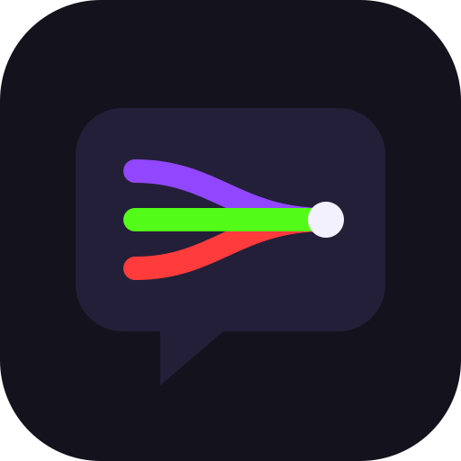
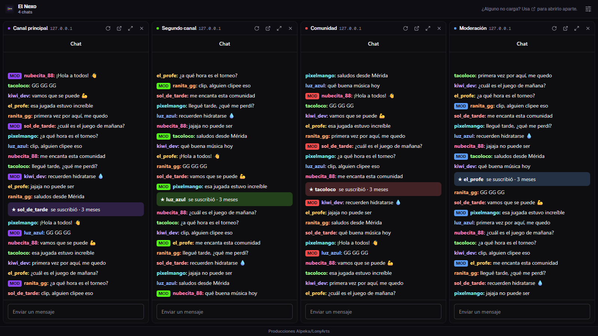
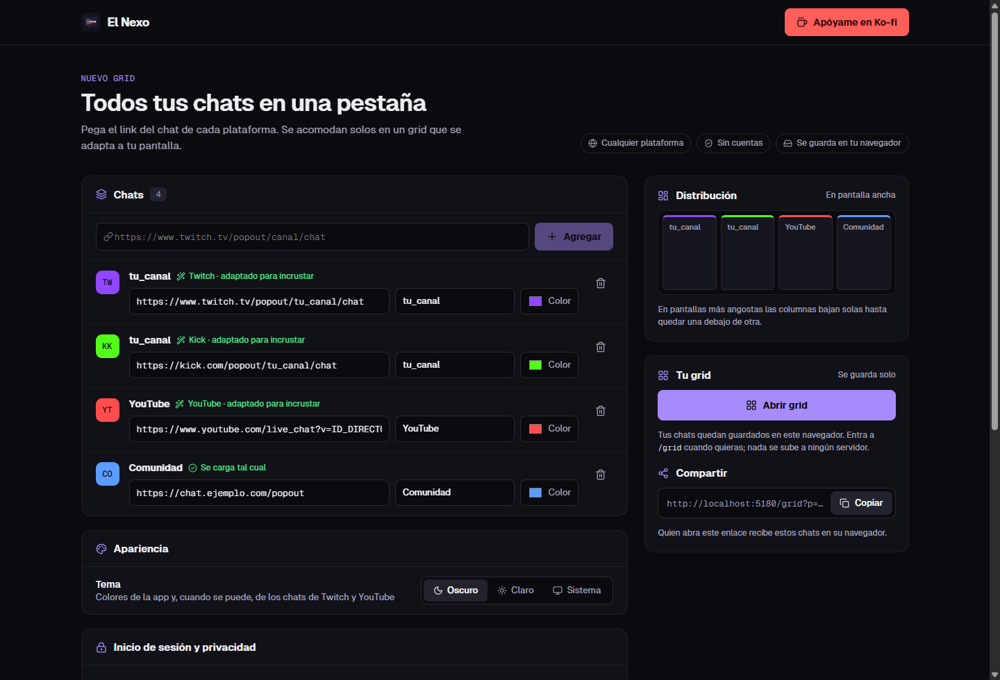
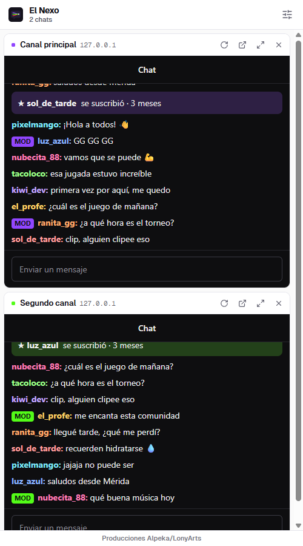

<div align="center">



# El Nexo

**Todos tus chats en una pestaña.**

Junta los chats de Twitch, Kick, YouTube o cualquier sitio en un grid que se adapta a tu pantalla.
Sin cuentas, sin servidores: todo se guarda en tu navegador.

[](https://github.com/Loon-7w7/ElNexo/releases)
[](https://preactjs.com)
[](https://vite.dev)
[](#publicar-en-vercel)
[](https://ko-fi.com/lonyarts)



<sub>Captura con chats de ejemplo.</sub>

</div>

## ¿Qué es?

Si sigues o moderas varios directos a la vez, terminas con una ventana por chat. **El Nexo** los junta en una sola
pestaña: pegas el link del chat de cada plataforma y se acomodan solos en un grid. Ideal para streamers que transmiten
en varias plataformas, moderadores y comunidades.

## Características

- **Cualquier plataforma.** Pega el link del chat y listo. Twitch, YouTube y Kick se adaptan solos a su versión
  incrustable; cualquier otro sitio se carga tal cual.
- **Grid responsivo.** Las columnas se reparten el ancho de la pantalla; en móvil quedan una debajo de otra.
- **Acciones por chat.** Recargar, abrir en otra ventana, maximizar (<kbd>Esc</kbd> para volver) y quitar, sin
  recargar los demás.
- **Dirección limpia.** Tus chats se guardan en tu navegador: solo ves `/` y `/grid`.
- **Compartir.** Copia un enlace con tus chats; quien lo abra los recibe en su navegador.
- **Tema oscuro, claro o del sistema**, con animaciones suaves que respetan "reducir movimiento".
- **Privado y seguro.** Sin cuentas ni servidor. La app no puede ver lo que escribes en los chats (ver
  [Privacidad y seguridad](#privacidad-y-seguridad)).
- **Ligera.** Unos 16 KB de JavaScript comprimido.

<table>
  <tr>
    <td width="68%"></td>
    <td width="32%"></td>
  </tr>
  <tr>
    <td align="center"><sub>Configurador</sub></td>
    <td align="center"><sub>Móvil, tema claro</sub></td>
  </tr>
</table>

## Cómo se usa

1. **Copia el link del chat.** En cada plataforma abre el chat en ventana aparte y copia la dirección.
2. **Pégalo en el configurador.** Se le pone nombre y color solos; puedes cambiarlos.
3. **Abre el grid.** Todos tus chats a la vista. La próxima vez entra directo a `/grid`.

### Links que se adaptan solos

| Plataforma | Link que puedes pegar | Se carga como |
| --- | --- | --- |
| Twitch | `twitch.tv/canal` o `twitch.tv/popout/canal/chat` | `twitch.tv/embed/canal/chat?parent=<tu dominio>` |
| YouTube | `youtube.com/watch?v=ID`, `/live/ID`, `youtu.be/ID` o `live_chat?v=ID` | `youtube.com/live_chat?v=ID&embed_domain=<tu dominio>` |
| Kick | `kick.com/canal` o `kick.com/popout/canal/chat` | `kick.com/popout/canal/chat` |
| Cualquier otro | — | Tal cual |

Si un sitio no permite mostrarse dentro de otra página, el chat se verá en blanco: usa el botón ↗ para abrirlo aparte.

### ¿Un chat te pide iniciar sesión?

Es normal. Los navegadores tratan las cookies de un sitio incrustado como *cookies de terceros* y las separan, así que
el chat no ve la sesión que tienes abierta en otra pestaña. Inicia sesión dentro del chat o ábrelo aparte con ↗.
Escribe tu contraseña solo si el dominio que aparece junto al nombre del chat es el del sitio real.

## Privacidad y seguridad

- **No hay servidor ni cuentas.** Lo único que se guarda, y solo en tu navegador, es la lista de chats: nombre, color y link.
- **Cada chat va aislado.** La app no puede ver tu usuario, tu contraseña, tus cookies ni lo que escribes, y un chat no
  puede redirigir la pestaña principal (`sandbox`).
- **Enlaces compartidos no confiables.** Solo se aceptan links `https` de sitios públicos: se rechazan `javascript:`,
  credenciales en la URL (`https://twitch.tv@sitio-falso.com`), la red local y la propia app. Máximo 12 chats y nombres
  sin caracteres invisibles. Cada chat muestra su dominio real junto al nombre.
- **Cabeceras estrictas** (`vercel.json`): CSP sin `unsafe-inline`, la app no se puede incrustar en otras páginas
  (`frame-ancestors 'none'`), COOP, HSTS y `Permissions-Policy`.

## Desarrollo

Necesitas [Node.js](https://nodejs.org) 22.

```bash
npm install
npm run dev        # http://localhost:5173
npm run build      # sitio estático en dist/
npm run preview    # el build, con las mismas cabeceras de seguridad que Vercel
npm run lint
```

El nombre de la app se toma de `.env` (copia `.env.example`):

```env
VITE_APP_NAME="El Nexo"
VITE_APP_TAGLINE="Todos tus chats en una pestaña"
```

En local (`localhost`) se permiten chats `http` y de la red local, para poder probar.

<details>
<summary><b>Notas técnicas</b></summary>

- **Preact 11 sin `compat`** en lugar de React: en los inputs de texto se usa `onInput` (no `onChange`), los atributos
  SVG van en kebab-case (`stroke-width`) y los tamaños numéricos en `style` llevan `px` explícito.
- **Router propio** de unas 40 líneas (`src/lib/router.ts`) con rutas normales `/` y `/grid`.
- **Fuentes autoalojadas** (Geist vía `@fontsource`), solo caracteres latinos, con la principal precargada.
- **Íconos** de [Lucide](https://lucide.dev): solo se empaquetan los que se importan.
- **Animaciones solo con CSS** (sección "Animaciones" de `themes.css`): entrada escalonada con la variable `--i`,
  indicador de carga por chat y cambio de tema suave.
- **Compartir**: el enlace lleva `?p=Nombre|rrggbb|url` (uno por chat) y `theme`. Al abrirlo, `importSharedConfig`
  (`src/lib/config.ts`) lo guarda en `localStorage` y limpia la dirección. Un enlace sin chats válidos no borra lo guardado.

```
src/
├── main.tsx                 # Arranque, fuentes, importar enlace compartido
├── App.tsx                  # Rutas (/ y /grid)
├── pages/
│   ├── Configurator.tsx     # Agregar chats, tema, distribución, abrir y compartir
│   └── GridView.tsx         # Grid responsivo de chats
├── components/
│   ├── PopoutPanel.tsx      # Un chat: barra de acciones + iframe con sandbox
│   ├── LoginNotice.tsx      # Aviso de inicio de sesión (grid y configurador)
│   └── ui.tsx               # Logo, badges, segmented, footer
├── hooks/useResolvedTheme.ts
├── lib/
│   ├── brand.ts             # Nombre (desde .env), créditos y link de Ko-fi
│   ├── router.ts            # Router mínimo
│   ├── config.ts            # Validación, guardado e importación de chats
│   └── embeds.ts            # Link del chat → URL incrustable
└── styles/themes.css        # Tokens oscuro/claro, estilos y animaciones
```

</details>

## Publicar en Vercel

Todo está listo para el plan gratuito (Hobby): `vercel.json` trae el build, la reescritura de rutas (para que `/grid`
funcione al recargar), la caché y las cabeceras.

1. En [vercel.com/new](https://vercel.com/new) importa este repositorio. Vercel detecta Vite: no hay que cambiar nada.
2. *Deploy*. Cada `git push` vuelve a publicar solo.
3. (Opcional) En *Settings → Environment Variables* agrega `VITE_APP_NAME` y `VITE_APP_TAGLINE`.

O desde la terminal: `npx vercel` (prueba) y `npx vercel --prod` (producción).

En otro hosting hay que configurar la reescritura de toda ruta a `index.html` ("SPA fallback") y las cabeceras.
Cada [release](https://github.com/Loon-7w7/ElNexo/releases) incluye el sitio ya compilado en un `.zip`.

## Créditos

Hecho por **Producciones Alpeka/LonyArts**. Si te sirve, puedes apoyar el proyecto en
[Ko-fi](https://ko-fi.com/lonyarts) ☕

Los cambios de cada versión están en el [CHANGELOG](CHANGELOG.md).

© 2026 Producciones Alpeka/LonyArts. Todos los derechos reservados. El código es visible con fines de consulta;
no se concede permiso para copiarlo, modificarlo ni redistribuirlo sin autorización.
